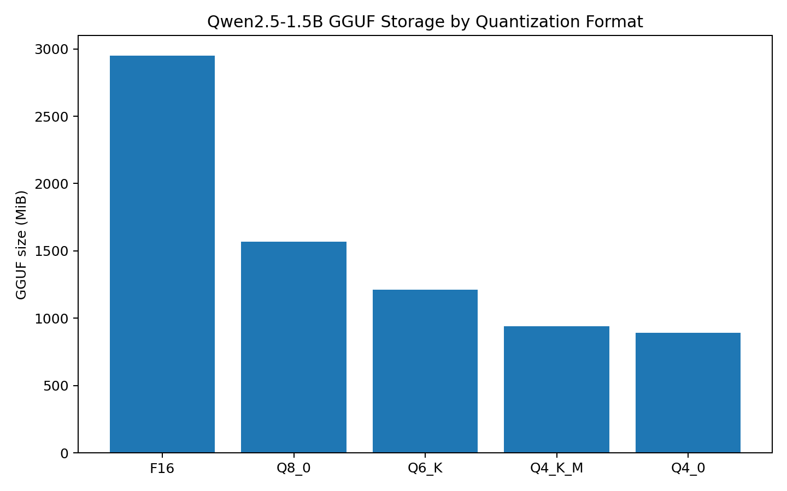
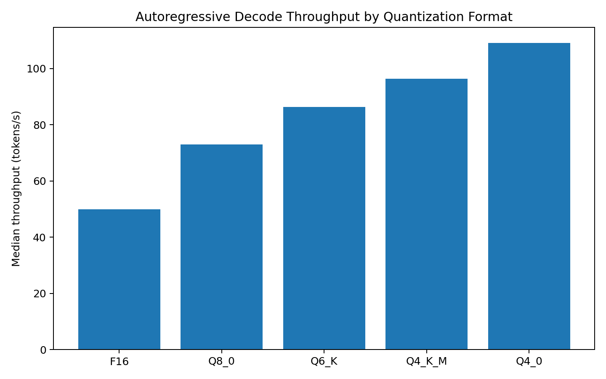
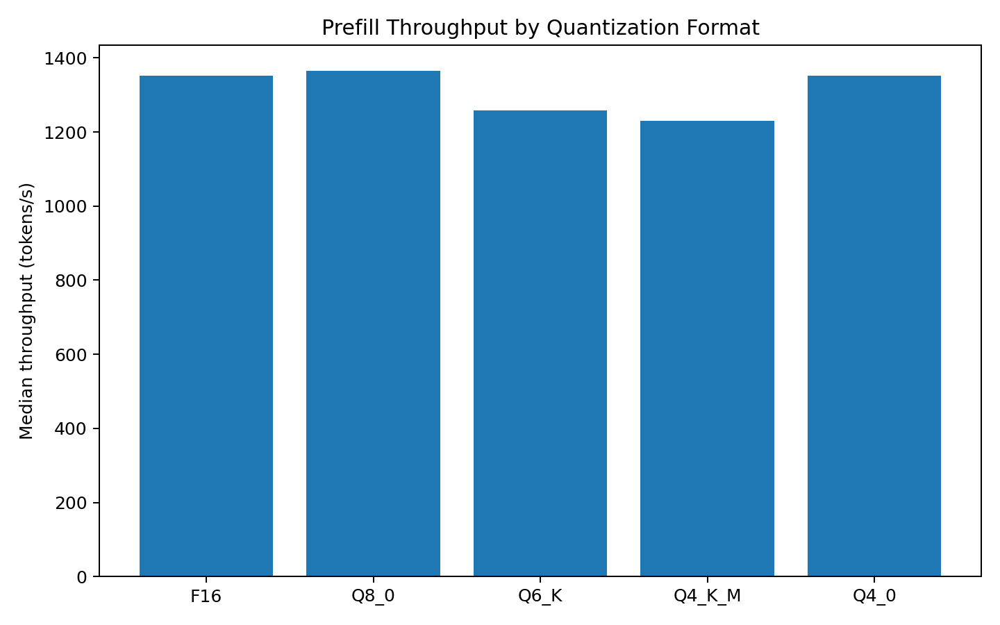
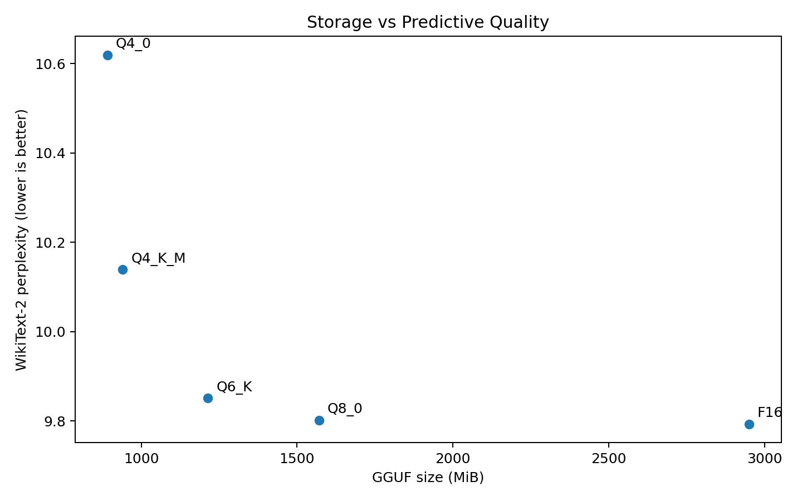
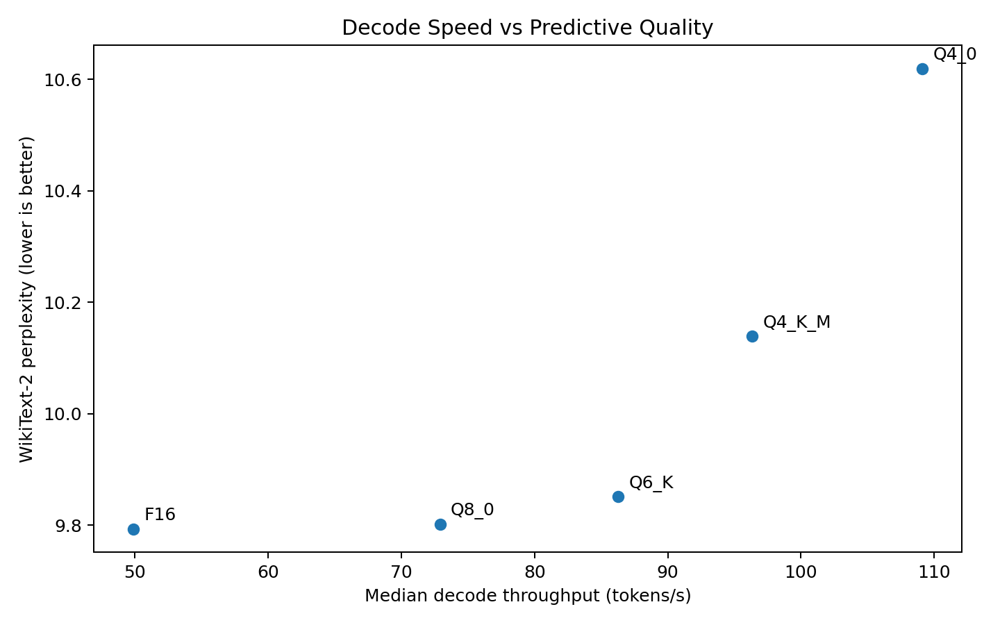

## Quantization Benchmark Results

This experiment evaluates how GGUF quantization format affects storage,
inference performance, and next-token predictive quality for the same
Qwen2.5-1.5B model.

All formats were derived from the same F16 GGUF and evaluated under a
frozen benchmark protocol on an Apple M2 Pro using the Metal backend.

### Experimental Setup

- Model: Qwen2.5-1.5B
- Hardware: Apple M2 Pro, 16 GB unified memory
- Backend: Metal
- llama.cpp commit:
  `e71b80510c848c00175924ecf3c40333ccae8eb5`
- Context size: 512
- Batch size: 256
- Threads: 6
- Performance runs: 5 measured trials per workload
- Prefill workload: fixed 256-token prompt
- Decode workload: fixed 32-token prompt + 128 autoregressive decode steps
- Quality corpus: WikiText-2 raw test split
- WikiText-2 SHA-256:
  `173c87a53759e0201f33e0ccf978e510c2042d7f2cb78229d9a50d79b9e7dd08`

Median performance is reported while preserving all individual runs in
`results/parsed_runs.csv`.

### Results

| Format | GGUF Size (MiB) | Median Load (ms) | Prefill (tok/s) | Decode (tok/s) | E2E (tok/s) | WikiText-2 PPL |
| --- | ---: | ---: | ---: | ---: | ---: | ---: |
| F16 | 2950.35 | 2728.17 | 1351.57 | 49.88 | 49.00 | 9.7928 |
| Q8_0 | 1570.29 | 390.63 | 1365.37 | 72.93 | 71.44 | 9.8015 |
| Q6_K | 1213.78 | 337.13 | 1257.84 | 86.28 | 82.13 | 9.8512 |
| Q4_K_M | 940.37 | 345.01 | 1229.99 | 96.34 | 93.26 | 10.1388 |
| Q4_0 | 891.64 | 315.57 | 1352.25 | 109.11 | 103.68 | 10.6195 |

Lower perplexity indicates better next-token predictive fit on the
WikiText-2 evaluation corpus.

### Key Observations

#### Storage

Quantization substantially reduced GGUF storage requirements.

Relative to F16:

- Q8_0 was 46.8% smaller.
- Q6_K was 58.9% smaller.
- Q4_K_M was 68.1% smaller.
- Q4_0 was 69.8% smaller.

Q4_0 was the smallest tested artifact at 891.64 MiB.



#### Autoregressive Decode

Median decode throughput increased monotonically across the tested
sequence:

`F16 -> Q8_0 -> Q6_K -> Q4_K_M -> Q4_0`

Q4_0 reached 109.11 tok/s compared with 49.88 tok/s for F16, or
approximately 2.19x the F16 decode throughput.

Relative to F16:

- Q8_0: +46.2%
- Q6_K: +73.0%
- Q4_K_M: +93.1%
- Q4_0: +118.7%

These are measured performance differences. The benchmark does not
establish the underlying cause of those differences.



#### Prefill

Prefill did not follow the same ordering as decode.

Q8_0 produced the highest median prefill throughput at 1365.37 tok/s,
while Q6_K and Q4_K_M were slower than F16 despite having smaller model
artifacts.

F16 and Q4_0 produced nearly identical median prefill throughput
(1351.57 vs. 1352.25 tok/s). Given the observed run-to-run variability,
this difference should not be treated as meaningful.

This result demonstrates that a smaller quantized model does not
automatically imply higher throughput for every phase of inference.



#### Predictive Quality

Perplexity increased as quantization became more aggressive:

- F16: 9.7928
- Q8_0: 9.8015
- Q6_K: 9.8512
- Q4_K_M: 10.1388
- Q4_0: 10.6195

Relative to F16, the perplexity increase was approximately:

- Q8_0: +0.09%
- Q6_K: +0.60%
- Q4_K_M: +3.53%
- Q4_0: +8.44%

Q8_0 and Q6_K therefore preserved WikiText-2 predictive fit relatively
closely while substantially reducing storage and increasing decode
throughput.

Perplexity is not treated here as a complete measure of reasoning,
factuality, instruction following, human preference, or general model
quality.



### Speed / Quality Tradeoff

The benchmark shows a clear tradeoff between autoregressive decode
throughput and WikiText-2 perplexity.



Under this specific experiment:

- **F16** is the quality-first choice because it produced the lowest
  measured perplexity.
- **Q6_K** provides a strong balanced operating point: approximately
  59% lower storage and 73% higher median decode throughput than F16,
  with only a 0.60% increase in WikiText-2 perplexity.
- **Q4_0** is the compression/decode-performance choice: approximately
  70% lower storage and 2.19x F16 decode throughput, with the largest
  measured perplexity increase.

These conclusions apply only to the tested model, hardware, llama.cpp
revision, backend, workloads, and evaluation corpus.

### Measurement Variability

Five measured trials were retained for each performance workload.

Several prefill series showed run-order drift rather than a single
isolated outlier. Decode variability also differed substantially between
formats. No measured runs were removed after observing the results.

The frozen protocol was therefore preserved instead of introducing
post-hoc warmup changes or selectively discarding measurements.

Raw run-level measurements are available in:

`results/parsed_runs.csv`

The summarized results are available in:

`results/performance_summary.csv`

### Open Hypotheses

The following are intentionally framed as hypotheses rather than causal
claims:

1. **Decode performance:** Reduced weight traffic and/or
   quantization-specific kernels may contribute to the higher decode
   throughput observed for quantized formats. Profiling is required to
   determine whether memory traffic, kernel execution, or another factor
   is responsible.

2. **Prefill behavior:** Prefill may have a different compute/memory
   balance from single-token decode, causing dequantization cost and
   kernel implementation details to affect the formats differently.

3. **Run-order drift:** Changes in device or runtime state may contribute
   to the measured throughput drift across repeated runs. Possible
   mechanisms include power/thermal state, Metal runtime behavior, or
   other system effects, but none were measured directly in this
   experiment.

Future profiling work should test these hypotheses rather than treating
them as explanations established by the current benchmark.

### Reproducing the Experiment

Performance benchmarks:

```bash
./scripts/run_benchmarks.sh
```

Perplexity evaluation:

```bash
./scripts/run_perplexity.sh
```

Parse and summarize results:

```bash
python3 scripts/analyze_results.py
```

Generate plots:

```bash
python3 scripts/plot_results.py
```

See `PROTOCOL.md` for the frozen benchmark methodology and
`metadata/perplexity_method.md` for the quality-evaluation procedure.